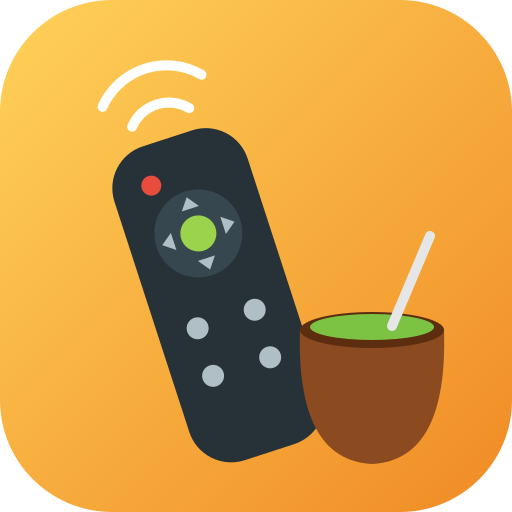
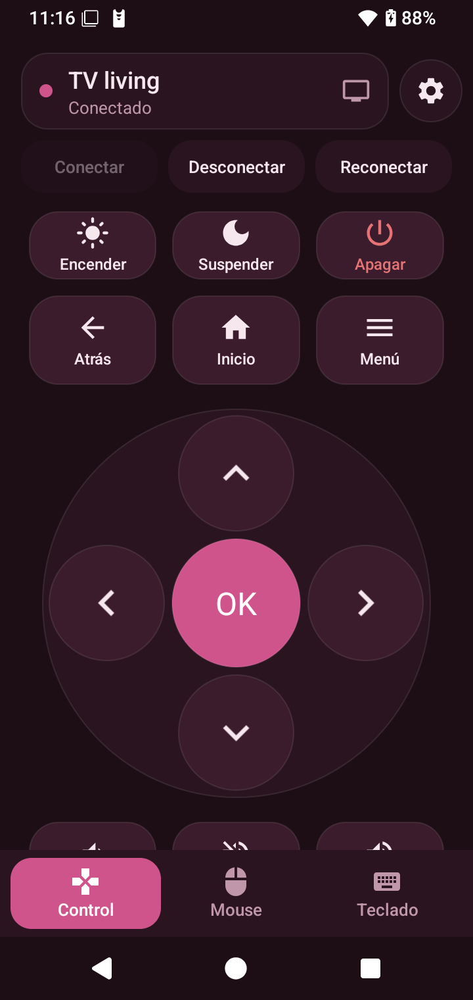
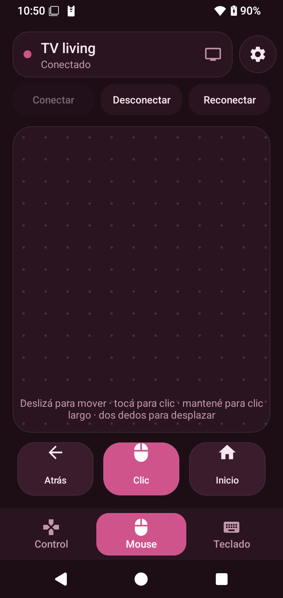
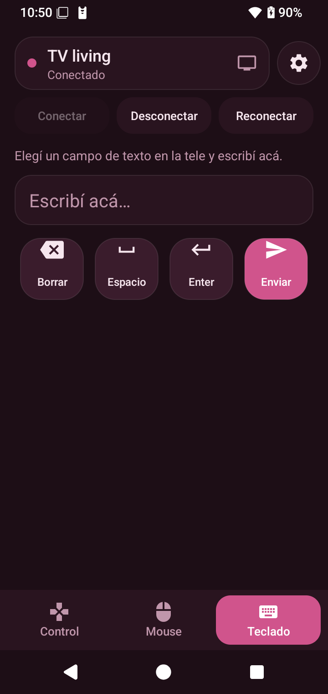

<h1 align="center">RemoteMate</h1>

<h2 align="center"><a href="https://github.com/matcarfer/RemoteMate/releases/download/v2.1.2/RemoteMate-2.1.2.apk">⬇ Download APK</a></h2>

  <a href="README.md">Español</a> · <b>English</b>  
Use your phone as the remote, mouse and keyboard of your TV box. 
Over your Wi-Fi, encrypted, no ads and no cloud. 
<b>Compatible with Android 4.4 to 16.</b>

  
  
  

**How to use:** install the same app on the box and on the phone, open it on both, tap the box and type the code. 
The box needs **one** of these: root, Accessibility or network ADB.

  <a href="https://cafecito.app/matcarfer">☕ Cafecito</a> · <a href="https://ko-fi.com/matcarfer">☕ Ko-fi</a> · <a href="https://www.patreon.com/matcarfer">❤ Patreon</a> 
  <a href="https://github.com/matcarfer/biblioteca/blob/main/README.en.md">📚 Software library</a>

---

Free, closed source. Do not redistribute: share this link. No warranty. <a href="LICENSE.en">License</a> · <a href="PRIVACY.md">Privacy</a> · <a href="https://www.virustotal.com/gui/file/518e3edb1ae13f877e4e63ada0f456d0166f057ee8c1250376b60e9cb88fe2aa">VirusTotal</a>
