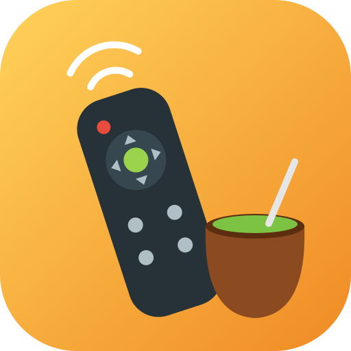
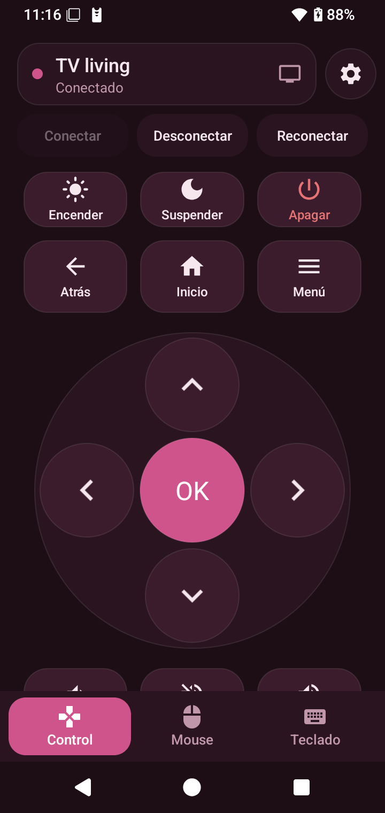
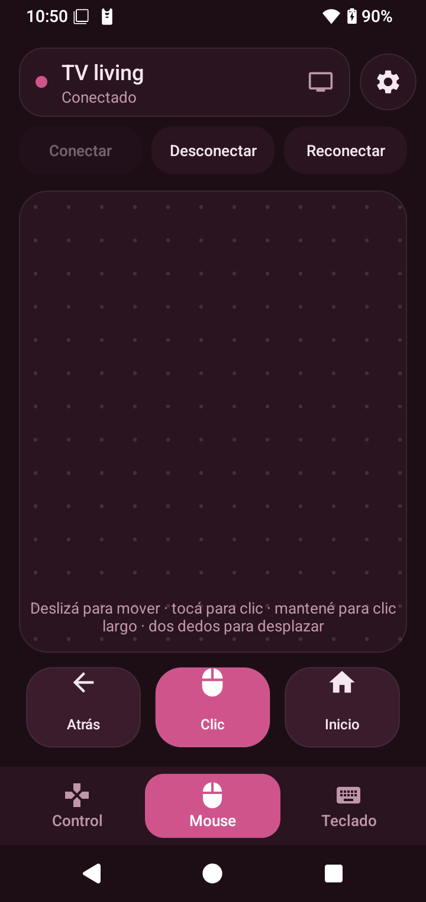
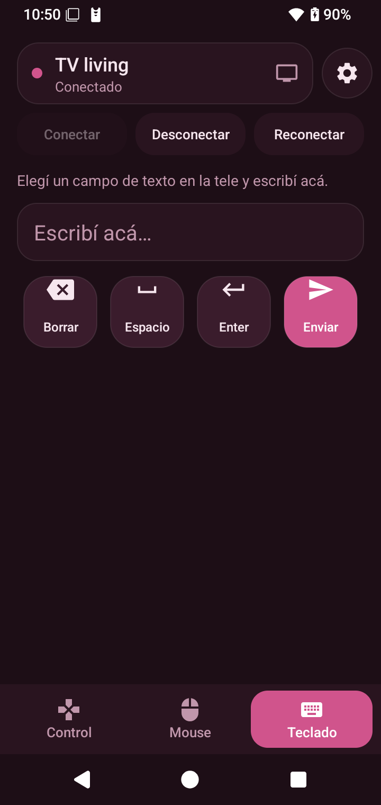

<h1 align="center">RemoteMate</h1>

<h2 align="center"><a href="https://github.com/matcarfer/RemoteMate/releases/download/v2.1.2/RemoteMate-2.1.2.apk">⬇ Descargar APK</a></h2>

  <b>Español</b> · <a href="README.en.md">English</a>  
Usá el celular para controlar, sin control remoto, Chromecast con Google TV, 
Smart TVs con Android TV o Google TV y convertidores Smart Android. 
Por tu Wi-Fi, cifrado, sin publicidad ni nube. 
<b>Compatible con Android 4.4 a 16.</b>

  
  
  

**Cómo se usa:** instalá la misma app en la tele o el convertidor y en el celular, abrila en los dos, tocá la tele o el convertidor y poné el código. 
La tele o el convertidor necesita **una** de estas: root, Accesibilidad o ADB por red.

  <a href="https://cafecito.app/matcarfer">☕ Cafecito</a> · <a href="https://ko-fi.com/matcarfer">☕ Ko-fi</a> · <a href="https://www.patreon.com/matcarfer">❤ Patreon</a> 
  <a href="https://github.com/matcarfer/biblioteca">📚 Biblioteca de software</a>

---

Gratis, de código cerrado. No redistribuir: compartí este link. Sin garantía. <a href="LICENSE">Licencia</a> · <a href="PRIVACY.es.md">Privacidad</a> · <a href="https://www.virustotal.com/gui/file/518e3edb1ae13f877e4e63ada0f456d0166f057ee8c1250376b60e9cb88fe2aa">VirusTotal</a>
